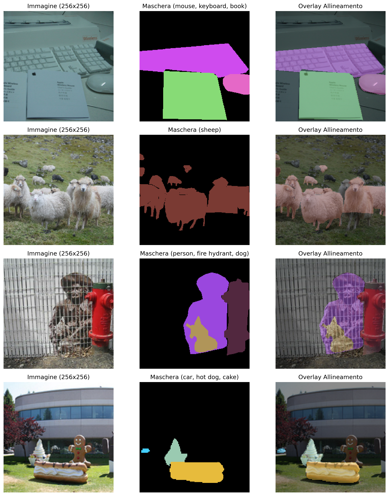
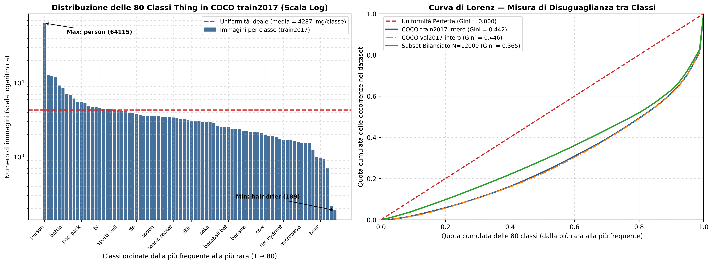
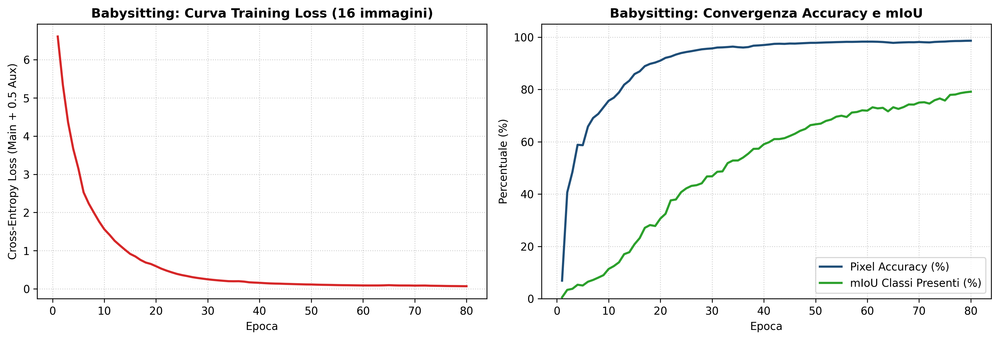
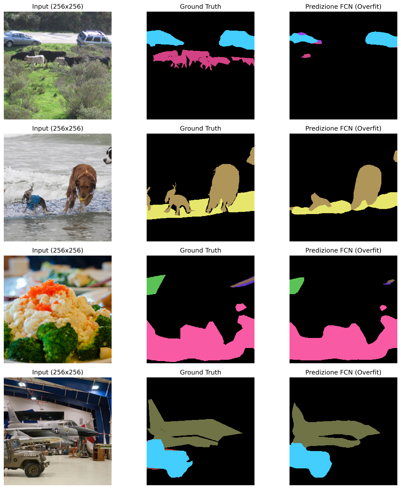
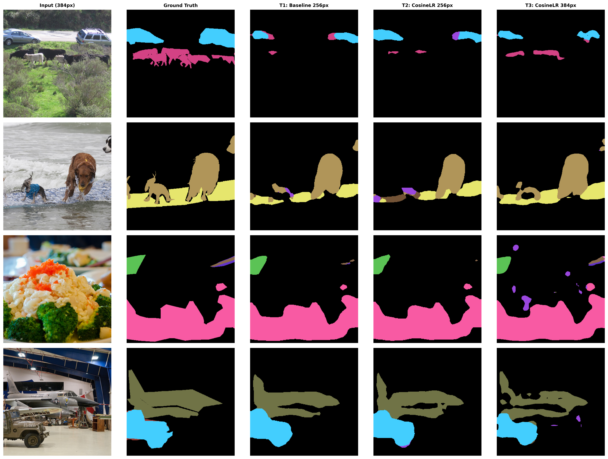

<div align="center">

# IPCV — Semantic & Instance Segmentation (Group H3)

**End-to-End Experimental Pipeline: From-Scratch FCN Training, Loss Function Ablation, Cross-Dataset Transfer Learning, Zero-Shot Foundation Models & Explainable AI**

[](https://pytorch.org/)
[](https://pytorch.org/vision/stable/models/fcn.html)
[](https://cocodataset.org/)
[](https://github.com/facebookresearch/Mask2Former)
[](#1-obiettivi-e-specifiche-di-progetto-h3)
[](#3-roadmap-sperimentale-e-stato-di-avanzamento)

<p align="center">
  <a href="#1-obiettivi-e-specifiche-di-progetto-h3">Specifiche H3</a> •
  <a href="#2-architettura-della-repository">Struttura Repo</a> •
  <a href="#3-roadmap-sperimentale-e-stato-di-avanzamento">Roadmap</a> •
  <a href="#4-indice-della-documentazione-tecnica">Documentazione</a> •
  <a href="#5-highlight-diagnostici-notebook-1">Diagnostica & Risultati</a> •
  <a href="#6-setup-e-riproducibilità">Setup</a>
</p>

</div>

---

## 1. Obiettivi e Specifiche di Progetto (H3)

Repository dedicata allo sviluppo metodico, documentato e riproducibile del progetto universitario di **Image Processing and Computer Vision (IPCV) — Traccia H3 (Semantic/Instance Segmentation)**. L'obiettivo è progettare, diagnosticare e confrontare rigorosamente paradigmi diversi di segmentazione densa e d'istanza su due benchmark standard (**COCO 2017** e **Cityscapes**), affiancando all'analisi quantitativa uno studio di interpretabilità delle feature apprese.

### Requisiti Sperimentali (`H3.pdf`)

| Area | Requisito Tecnico | Dettaglio Implementativo & Riferimenti |
| :--- | :--- | :--- |
| **Datasets** | **COCO 2017** & **Cityscapes** | Addestramento primario *from scratch* su **COCO 2017** (formulazione *Thing* a $C=81$ classi: background + 80 categorie) e dominio target urbano **Cityscapes** per transfer learning e benchmark finale. |
| **1. Training From Scratch** | **FCN con Babysitting** | Implementazione e addestramento da zero di `torchvision.models.segmentation.fcn_resnet50` su COCO 2017 applicando il protocollo diagnostico *CS231n* (sanity check loss iniziale, overfitting su mini-batch, rapporto *update-to-weight*). |
| **2. Loss Functions** | **Studio Comparativo & Ibridi** | Addestramento e confronto controllato a parità di inizializzazione (`shared_init_fcn_resnet50.pt`) tra diverse funzioni di perdita e loro combinazioni (**Cross-Entropy**, **Jaccard**, **Dice**, **Focal Loss**). |
| **3. Transfer Learning (Semantic)** | **Fine-Tuning `yourFCN`** | Adattamento del modello `yourFCN` (pre-addestrato *from scratch* su COCO 2017) al dataset **Cityscapes**. |
| **4. Transfer Learning (Instance)** | **Fine-Tuning YOLOv11** | Fine-tuning di **YOLOv11** per il task di *Instance Segmentation* sul dataset **Cityscapes**. |
| **5. Foundation Models** | **Mask2Former (Zero-Shot)** | Valutazione di **Mask2Former** (`facebookresearch/Mask2Former`) su **Cityscapes** **senza alcun riaddestramento** (*zero-shot / no re-train*). |
| **6. Valutazione Comparativa** | **Metriche Standardizzate** | **Semantic Segmentation:** `IoU` / `mIoU`, `F1 Score`, `Confusion Matrix`.<br>**Instance Segmentation:** `Precision`, `Recall`, `AP`, `mAP`. |
| **7. Explainable AI (XAI)** | **Activation Maximization** | Sintesi tramite *Activation Maximization* su layer e filtri selezionati della FCN addestrata per interpretare le strutture visive catturate (bordi, texture, pattern locali, regioni semantiche). |

---

## 2. Architettura della Repository

Il progetto adotta una separazione netta tra **notebook eseguibili** (`notebooks/`), **documentazione ingegneristica strutturata** (`docs/`) e **artefatti visivi di diagnostica** (`images/`).

```text
IPCV-Semantic-Segmentation/
├── README.md
├── docs/
│   └── Notebook1/
│       ├── step-1/
│       │   ├── [01_EDL] Step 1 - Engineering Decision Log.md
│       │   ├── [01_QA] Step 1-2 - QA - Scelta_COCO_Thing_vs_Stuff_e_Rasterizzazione.md
│       │   ├── [01_REPORT] Step 1 - Setup, Configurazione e Ispezione Dati (COCO 2017).md
│       │   └── [01_TPR] Step 1 - Technical Progress Report.md
│       ├── step-2/
│       │   ├── [02_EDL] Step 2 - Engineering Decision Log.md
│       │   ├── [02_QA] Step 2 - QA - Normalizzazione_ImageNet_vs_COCO.md
│       │   ├── [02_QA] Step 2 - QA - Preprocessing_Geometrico_e_Validazione_Deterministica.md
│       │   ├── [02_QA] Step 2 - QA - Uniformita_Dataset.md
│       │   ├── [02_REPORT] Step 2 - Analisi Statistica JSON, Pipeline Dati e Ribilanciamento.md
│       │   └── [02_TPR] Step 2 - Technical Progress Report.md
│       └── step-3/
│           ├── [03_EDL] Step 3 - Engineering Decision Log.md
│           ├── [03_QA] Step 3 - QA - Architettura_FCN_ResNet50_OutputStride_e_AuxLoss.md
│           ├── [03_QA] Step 3 - QA - Protocollo_Babysitting_CS231n_e_AdamW.md
│           ├── [03_QA] Step 3-BIS - QA - Analisi_Mini_Ablation_BatchNorm_e_Scelta_256px.md
│           ├── [03_REPORT] Step 3 - Architettura FCN from scratch, Babysitting e Diagnostica.md
│           └── [03_TPR] Step 3 - Technical Progress Report.md
├── images/
│   ├── COCO2017/
│   │   └── coco2017_label_hierarchy.png
│   └── Notebook1/
│       ├── step-1/
│       ├── step-2/
│       │   ├── 01_step2_dataloader_sanity_overlay.png
│       │   ├── 02_step2_coco_uniformity_lorenz_gini.png
│       │   ├── 02_step2_coco_uniformity_lorenz_gini.svg
│       │   ├── 03_step2_coco_class_distribution_dumbbell.png
│       │   └── 03_step2_coco_class_distribution_dumbbell.svg
│       └── step-3/
│           ├── 04_step3_babysitting_loss_metrics_curves.png
│           ├── 04_step3_babysitting_loss_metrics_curves.svg
│           ├── 05_step3_babysitting_overfit_predictions.png
│           └── 06_step3bis_mini_ablation_visual_comparison.png
└── notebooks/
    └── Notebook1_SetupDatasetCOCO2017_Babysitting_(Step1_Step3-BIS).ipynb
```

### Convenzioni Documentali (`docs/`)

Ogni step sperimentale è tracciato attraverso quattro tipologie di documenti Markdown complementari:

* **`[XX_REPORT]` — Technical & Experimental Report:** Documento completo con inquadramento teorico, codice, risultati numerici, diagnostica e analisi critica.
* **`[XX_TPR]` — Technical Progress Report:** Sintesi esecutiva orientata ai risultati, alle metriche e allo stato di avanzamento della milestone.
* **`[XX_EDL]` — Engineering Decision Log:** Diario delle decisioni architetturali con alternative valutate, motivazioni tecniche, criticità e trade-off.
* **`[XX_QA]` — Deep-Dive Methodological Q&A:** Approfondimenti teorico-pratici su nodi critici (es. formulazione COCO Thing vs Stuff, normalizzazione, BatchNorm, Output Stride, protocollo CS231n).

---

## 3. Roadmap Sperimentale e Stato di Avanzamento

Il progetto è strutturato in **9 step incrementali** distribuiti su notebook modulari per garantire isolamento dei test, tracciabilità e riproducibilità su ambiente Kaggle GPU:

| Step | Fase Progettuale | Notebook | Stato | Deliverable & Evidenze Chiave |
| :---: | :--- | :---: | :---: | :--- |
| **Step 1** | Setup Ambiente & Ispezione Dati (COCO 2017) | `Notebook1` | ✅ Completato | Verifica integrità split (`118.287` train / `5.000` val / `40.670` test), rilevamento immagini grayscale (`L`), risoluzioni e configurazione deterministica. |
| **Step 2** | Pipeline Dati, Rasterizzazione & Analisi Statistica | `Notebook1` | ✅ Completato | `SegmentationDataset` *on-the-fly* con `pycocotools`, trasformazioni geometriche sincronizzate (`InterpolationMode.NEAREST`), analisi disuguaglianza (Lorenz/Gini) e ribilanciamento. |
| **Step 3** | Architettura `FCN-ResNet50` & Babysitting CS231n | `Notebook1` | ✅ Completato | Inizializzazione *from scratch* ($C=81$), verifica loss teorica ($-\ln(1/81) = 4.3944$), diagnostica gradienti (`AdamW`), overfitting su 16 immagini e checkpoint condiviso. |
| **Step 3-BIS** | Mini-Ablation Diagnostica (`BatchNorm` & Risoluzione) | `Notebook1` | ✅ Completato | Analisi comportamento `BatchNorm2d` in `eval()` su `DataParallel` e confronto computazionale/qualitativo `256px` vs `384px` per consolidare `CROP_SIZE = 256`. |
| **Step 4** | Studio Comparativo Loss Functions su COCO 2017 | `Notebook2` | 🔜 Prossimo | Training comparativo *from scratch* con **Cross-Entropy**, **Jaccard**, **Dice**, **Focal Loss** e combinazioni ibride a parità di pesi iniziali. |
| **Step 5** | Valutazione Semantica & Analisi Errori su COCO Val | `Notebook2` | ⏳ Pianificato | Calcolo `mIoU`, `F1 Score`, `Confusion Matrix` e selezione del miglior checkpoint `yourFCN`. |
| **Step 6** | Transfer Learning: Fine-Tuning `yourFCN` su Cityscapes | `Notebook3` | ⏳ Pianificato | Adattamento testa di segmentazione sulle classi Cityscapes e fine-tuning su dominio urbano. |
| **Step 7** | Instance Segmentation: Fine-Tuning YOLOv11 su Cityscapes | `Notebook3` | ⏳ Pianificato | Addestramento e valutazione (`Precision`, `Recall`, `AP`, `mAP`) su Cityscapes. |
| **Step 8** | Zero-Shot Benchmarking con Mask2Former | `Notebook4` | ⏳ Pianificato | Inferenza *without re-train* su Cityscapes e allineamento tassonomico per confronto equo. |
| **Step 9** | Explainable AI (Activation Maximization) & Sintesi Finale | `Notebook4` | ⏳ Pianificato | Visualizzazione filtri/layer FCN, interpretazione feature e tabella comparativa finale di tutti i metodi. |

---

## 4. Indice della Documentazione Tecnica

### Notebook 1 — Setup COCO 2017, Data Pipeline & FCN Babysitting (`Step 1` – `Step 3-BIS`)

* **Notebook eseguibile:** [`Notebook1_SetupDatasetCOCO2017_Babysitting_(Step1_Step3-BIS).ipynb`](<notebooks/Notebook1_SetupDatasetCOCO2017_Babysitting_(Step1_Step3-BIS).ipynb>)

<details open>
<summary><b>Step 1 — Setup, Configurazione e Ispezione Dati (COCO 2017)</b></summary>

* 📄 **Report Completo:** [`[01_REPORT] Step 1 - Setup, Configurazione e Ispezione Dati (COCO 2017).md`](<docs/Notebook1/step-1/[01_REPORT] Step 1 - Setup, Configurazione e Ispezione Dati (COCO 2017).md>)
* 📊 **Technical Progress Report:** [`[01_TPR] Step 1 - Technical Progress Report.md`](<docs/Notebook1/step-1/[01_TPR] Step 1 - Technical Progress Report.md>)
* 🧭 **Engineering Decision Log:** [`[01_EDL] Step 1 - Engineering Decision Log.md`](<docs/Notebook1/step-1/[01_EDL] Step 1 - Engineering Decision Log.md>)
* 🎓 **Q&A Approfondimento:** [`[01_QA] Step 1-2 - QA - Scelta_COCO_Thing_vs_Stuff_e_Rasterizzazione.md`](<docs/Notebook1/step-1/[01_QA] Step 1-2 - QA - Scelta_COCO_Thing_vs_Stuff_e_Rasterizzazione.md>)

</details>

<details open>
<summary><b>Step 2 — Analisi Statistica JSON, Pipeline Dati e Ribilanciamento</b></summary>

* 📄 **Report Completo:** [`[02_REPORT] Step 2 - Analisi Statistica JSON, Pipeline Dati e Ribilanciamento.md`](<docs/Notebook1/step-2/[02_REPORT] Step 2 - Analisi Statistica JSON, Pipeline Dati e Ribilanciamento.md>)
* 📊 **Technical Progress Report:** [`[02_TPR] Step 2 - Technical Progress Report.md`](<docs/Notebook1/step-2/[02_TPR] Step 2 - Technical Progress Report.md>)
* 🧭 **Engineering Decision Log:** [`[02_EDL] Step 2 - Engineering Decision Log.md`](<docs/Notebook1/step-2/[02_EDL] Step 2 - Engineering Decision Log.md>)
* 🎓 **Q&A — Normalizzazione:** [`[02_QA] Step 2 - QA - Normalizzazione_ImageNet_vs_COCO.md`](<docs/Notebook1/step-2/[02_QA] Step 2 - QA - Normalizzazione_ImageNet_vs_COCO.md>)
* 🎓 **Q&A — Preprocessing:** [`[02_QA] Step 2 - QA - Preprocessing_Geometrico_e_Validazione_Deterministica.md`](<docs/Notebook1/step-2/[02_QA] Step 2 - QA - Preprocessing_Geometrico_e_Validazione_Deterministica.md>)
* 🎓 **Q&A — Uniformità Dataset:** [`[02_QA] Step 2 - QA - Uniformita_Dataset.md`](<docs/Notebook1/step-2/[02_QA] Step 2 - QA - Uniformita_Dataset.md>)

</details>

<details open>
<summary><b>Step 3 & Step 3-BIS — Architettura FCN from scratch, Babysitting e Mini-Ablation</b></summary>

* 📄 **Report Completo:** [`[03_REPORT] Step 3 - Architettura FCN from scratch, Babysitting e Diagnostica.md`](<docs/Notebook1/step-3/[03_REPORT] Step 3 - Architettura FCN from scratch, Babysitting e Diagnostica.md>)
* 📊 **Technical Progress Report:** [`[03_TPR] Step 3 - Technical Progress Report.md`](<docs/Notebook1/step-3/[03_TPR] Step 3 - Technical Progress Report.md>)
* 🧭 **Engineering Decision Log:** [`[03_EDL] Step 3 - Engineering Decision Log.md`](<docs/Notebook1/step-3/[03_EDL] Step 3 - Engineering Decision Log.md>)
* 🎓 **Q&A — Architettura FCN:** [`[03_QA] Step 3 - QA - Architettura_FCN_ResNet50_OutputStride_e_AuxLoss.md`](<docs/Notebook1/step-3/[03_QA] Step 3 - QA - Architettura_FCN_ResNet50_OutputStride_e_AuxLoss.md>)
* 🎓 **Q&A — Babysitting & AdamW:** [`[03_QA] Step 3 - QA - Protocollo_Babysitting_CS231n_e_AdamW.md`](<docs/Notebook1/step-3/[03_QA] Step 3 - QA - Protocollo_Babysitting_CS231n_e_AdamW.md>)
* 🎓 **Q&A — Mini-Ablation 256px:** [`[03_QA] Step 3-BIS - QA - Analisi_Mini_Ablation_BatchNorm_e_Scelta_256px.md`](<docs/Notebook1/step-3/[03_QA] Step 3-BIS - QA - Analisi_Mini_Ablation_BatchNorm_e_Scelta_256px.md>)

</details>

---

## 5. Highlight Diagnostici (`Notebook 1`)

### Analisi Statistica e Pipeline Dati (`Step 2`)

* **Rasterizzazione Semantica & Sanity Check:** Conversione *on-the-fly* delle annotazioni COCO (`instances_*.json`) in maschere dense 2D ($C=81$) con trasformazioni sincronizzate (`RandomCrop` / `CenterCrop` e `InterpolationMode.NEAREST` per evitare interpolazioni spurie tra ID di classe).
* **Sbilanciamento Multi-Granularità:** L'analisi tramite curve di Lorenz, coefficiente di Gini e *Dumbbell Chart* evidenzia una forte concentrazione sia a livello di occorrenze sia a livello di area pixel (con il `15.21%` delle istanze caratterizzate da lato equivalente $< 8\text{ px}$), motivando il ribilanciamento del campionamento e l'esplorazione di loss region/focal nello Step 4.

| Sanity Check DataLoader (Overlay) | Disuguaglianza Dataset (Lorenz & Gini) |
| :---: | :---: |
|  |  |

### Babysitting CS231n & Mini-Ablation (`Step 3` & `Step 3-BIS`)

* **Verifica Loss Iniziale & Flusso Gradienti:** Con `FCN-ResNet50` inizializzata *from scratch* ($C=81$), la Cross-Entropy iniziale misurata ($4.4173$, totale con ramo ausiliario $6.5704$) combacia con il valore teorico atteso a distribuzione uniforme ($-\ln(1/81) = 4.3944$, totale $6.5917$). L'ottimizzatore `AdamW` compensa lo sbilanciamento iniziale dei gradienti tra `layer4` e `conv1` attraverso i 50 strati senza pesi pre-addestrati.
* **Overfitting Controllato & Scelta `256x256`:** Sul mini-subset diagnostico (16 immagini, 80 epoche), la rete raggiunge il `98.62%` di Pixel Accuracy e `79.13%` di mIoU in modalità training. La mini-ablation dello **Step 3-BIS** dimostra che passare da `256x256` a `384x384` aumenta il tempo di calcolo di $4.3\times$ ($106.1\text{s} \rightarrow 455.8\text{s}$) senza benefici immediati sulla separabilità degli oggetti sub-stride (*Output Stride = 8*), confermando `CROP_SIZE = (256, 256)` come baseline computazionale ottimale per lo studio delle loss.

| Curve di Loss & Metriche (Babysitting) | Predizioni Overfit (16 Immagini) | Mini-Ablation Visiva (`Step 3-BIS`) |
| :---: | :---: | :---: |
|  |  |  |

---

## 6. Setup e Riproducibilità

### Stack Tecnologico
* **Framework Core:** `PyTorch`, `Torchvision` (`fcn_resnet50` senza pesi pre-addestrati per lo sviluppo *from scratch*)
* **Gestione Dataset & Annotazioni:** `pycocotools`, `Pillow` (`.convert("RGB")`), `NumPy`
* **Visualizzazione & Diagnostica:** `Matplotlib`, `Seaborn` (esportazione ad alta risoluzione in `.png` e `.svg`)
* **Hardware Target:** Ambiente Kaggle GPU (`2x NVIDIA Tesla T4` tramite `nn.DataParallel`, `BATCH_SIZE = 16`, `CROP_SIZE = 256`)

### Garanzie di Riproducibilità
1. **Seed Deterministico:** Fissato globalmente su Python `random`, `NumPy`, `PyTorch` CPU/CUDA e `cuDNN`.
2. **Validazione Deterministica:** Uso esclusivo di `CenterCrop` e `Resize` deterministico in fase di validazione per rendere confrontabili le metriche tra epoche e tra funzioni di perdita diverse.
3. **Checkpoint Iniziale Condiviso (`shared_init_fcn_resnet50.pt`):** I pesi casuali iniziali della `FCN-ResNet50` vengono salvati prima dello Step 4 affinché ogni esperimento di *loss ablation* parta esattamente dallo stesso punto nello spazio dei parametri.